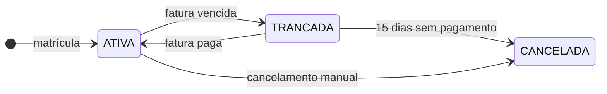
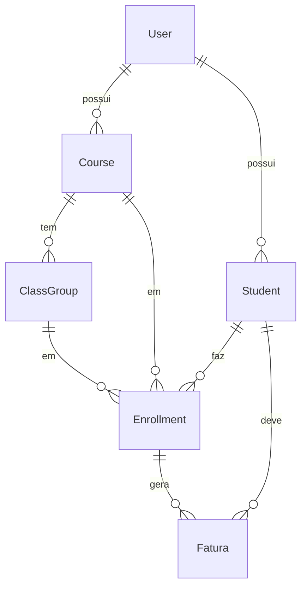

# Matrix

Sistema web para gestão de escolas e cursos livres: cadastro de cursos, turmas e alunos, matrículas com controle de vagas e faturamento recorrente com regras automáticas de vencimento, multa e bloqueio de matrícula.

Cada conta enxerga apenas os próprios dados: todas as entidades são vinculadas ao usuário autenticado.

## Funcionalidades

- **Autenticação** com cadastro e login de usuário (senha com hash `bcrypt`, sessão via JWT)
- **Cursos**: nome, código, valor e ciclo de cobrança (diária, semanal, mensal ou anual)
- **Turmas**: vinculadas a um curso, com limite de vagas e situação calculada automaticamente (`ABERTA` / `COMPLETA`)
- **Alunos**: cadastro com CPF, data de nascimento, e-mail e telefone (com máscaras no formulário), perfil com histórico de matrículas
- **Matrículas**: impedem matrícula duplicada no mesmo curso e matrícula em turma lotada, e geram um código sequencial por turma (ex.: `T2026A.001`)
- **Faturas**: a primeira é emitida na matrícula e as seguintes são geradas conforme o ciclo de cobrança do curso
- **Painéis com indicadores** em cada módulo (Chart.js): ocupação das turmas, cursos por ciclo de cobrança, evolução de emissões, faturamento por curso, faturas por status

## Regras de negócio

O ciclo de vida de matrícula e fatura é mantido em sincronia dentro de transações do banco:

| Evento | Efeito na fatura | Efeito na matrícula |
| --- | --- | --- |
| Matrícula criada | Fatura emitida com vencimento em 30 dias | `ATIVA`, ocupa uma vaga da turma |
| Fatura passa do vencimento | Status `VENCIDA` e multa de 10% sobre o valor | `TRANCADA`, libera a vaga |
| 15 dias após o vencimento sem pagamento | — | `CANCELADA` |
| Fatura paga | `PAGA` | Volta para `ATIVA` e ocupa novamente uma vaga (se houver) |



Outras regras:

- Contadores de alunos, vagas disponíveis e matrículas por aluno são atualizados atomicamente a cada mudança de status.
- Faturas recorrentes que deveriam ter sido emitidas desde a última consulta são geradas retroativamente ao listar as faturas.
- Excluir um aluno remove suas matrículas e faturas e devolve as vagas às turmas.

## Stack

| Camada | Tecnologias |
| --- | --- |
| Frontend | React 19, Vite, React Router, React Hook Form + Zod, Bootstrap 5, Chart.js, Axios |
| Backend | Node.js, Express 5, Prisma ORM, Zod, JSON Web Token, bcrypt |
| Banco de dados | PostgreSQL |
| Deploy | Vercel (frontend) |

## Arquitetura

```
backend/
  prisma/
    schema.prisma        modelo de dados
    migrations/          histórico de migrations
  src/
    routes/              definição das rotas por módulo
    controllers/         leitura da requisição e resposta HTTP
    services/            regras de negócio e acesso ao banco (Prisma)
    schemas/             validação de entrada com Zod
    middlewares/         autenticação JWT, validação e tratamento de erros
    errors/              AppError e tradução de erros do banco
    utils/               formatadores e cálculo de datas de cobrança
frontend/
  src/
    pages/               telas de cada módulo (listagem e perfil)
    components/          modais de formulário, tabela, gráficos, sidebar
    services/api.js      cliente Axios que envia o token em todas as requisições
```

O backend segue a sequência **rota → middleware (auth/validação) → controller → service**. Os erros de domínio são lançados como `AppError` e convertidos em respostas HTTP por um único middleware de erro, e os erros de validação do Zod retornam `400` com os campos inválidos.

### Modelo de dados



## API

Todas as rotas ficam sob o prefixo `/api`.

| Módulo | Rotas |
| --- | --- |
| Autenticação | `POST /sign-up`, `POST /login` |
| Alunos | `GET/POST /manage-students`, `GET/PATCH/DELETE /manage-students/:id`, `POST /manage-students/:id` (nova matrícula) |
| Cursos | `GET/POST /manage-courses`, `GET/PATCH/DELETE /manage-courses/:id` |
| Turmas | `GET/POST /manage-classes`, `GET/PATCH/DELETE /manage-classes/:id` |
| Matrículas | `GET/POST/PATCH /manage-enrollments/:id` |
| Faturas | `GET /manage-invoices`, `PATCH /manage-invoices/:id` |

Rotas autenticadas esperam o cabeçalho `Authorization: Bearer <token>`, que é devolvido no login.

## Como rodar localmente

Pré-requisitos: Node.js 20+ e um banco PostgreSQL (local ou hospedado, como Supabase ou Neon).

### Backend

```bash
cd backend
npm install
cp .env.example .env   # preencha as variáveis abaixo
npx prisma migrate deploy
npm run dev            # http://localhost:5000
```

| Variável | Descrição |
| --- | --- |
| `DATABASE_URL` | String de conexão do PostgreSQL usada pela aplicação |
| `DIRECT_URL` | Conexão direta usada pelo Prisma nas migrations (pode ser igual à `DATABASE_URL` em banco local) |
| `JWT_SECRET` | Segredo usado para assinar e validar os tokens |
| `PORT` | Porta da API (opcional, padrão `5000`) |

### Frontend

```bash
cd frontend
npm install
npm run dev            # http://localhost:5173
```

Por padrão o frontend aponta para `http://localhost:5000`. Para usar outra API, defina `VITE_API_URL` em `frontend/.env`.

## Próximos passos

- Testes automatizados para as regras de matrícula e faturamento
- Aplicar o middleware de autenticação de forma uniforme a todas as rotas de alunos e cursos
- Restringir o CORS ao domínio do frontend em produção
